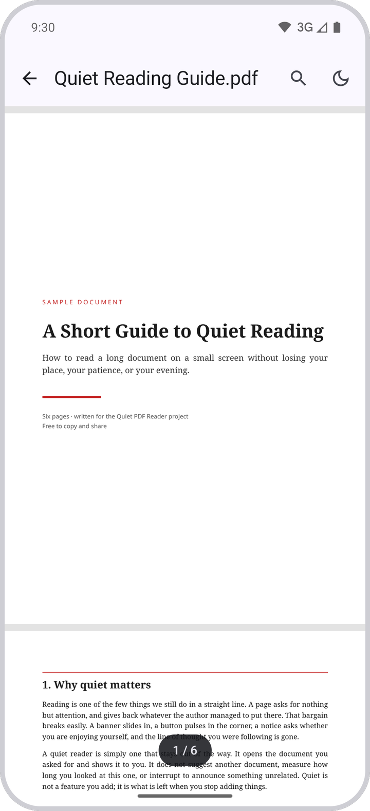
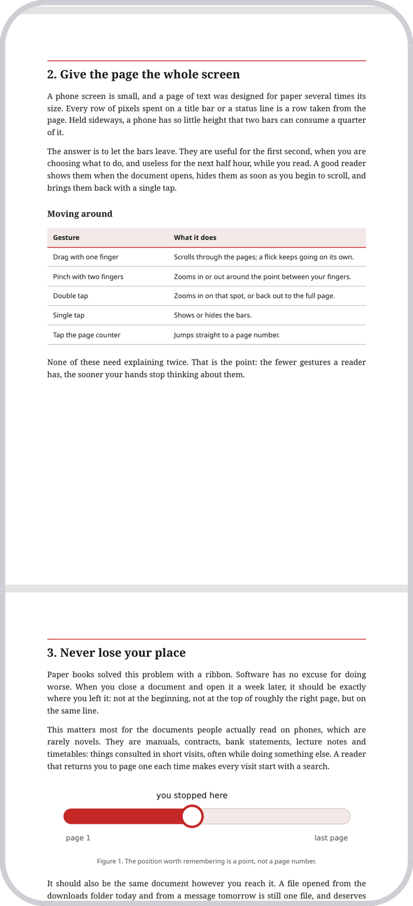
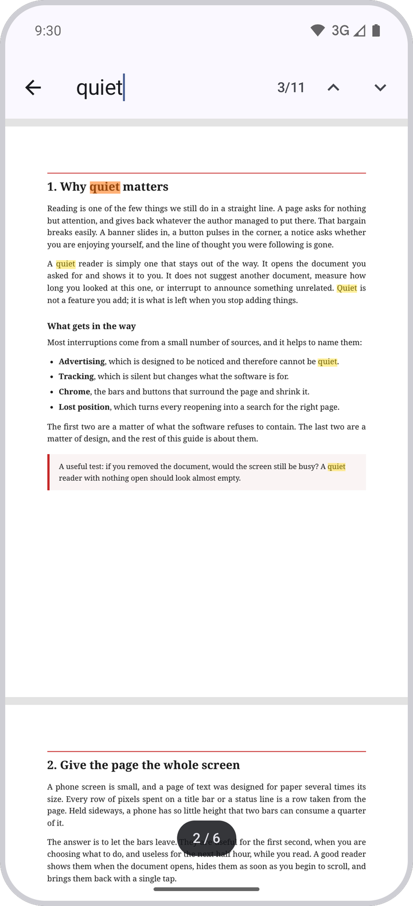
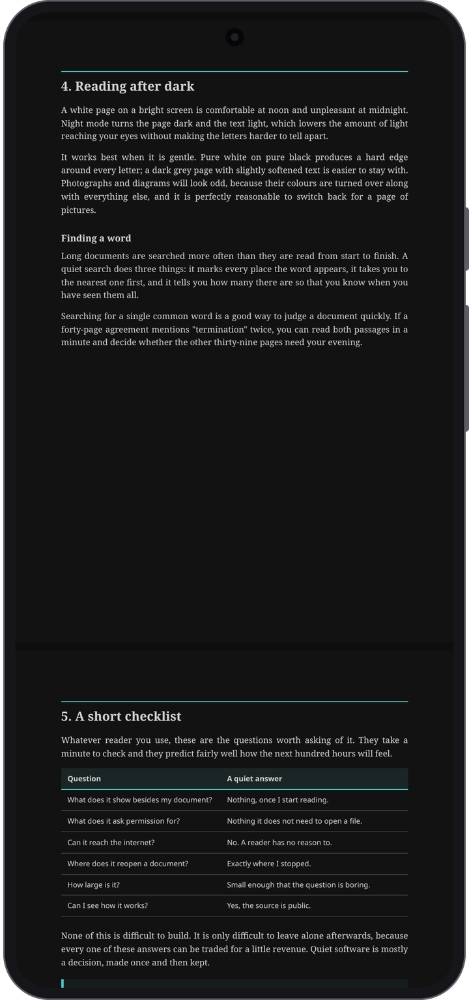
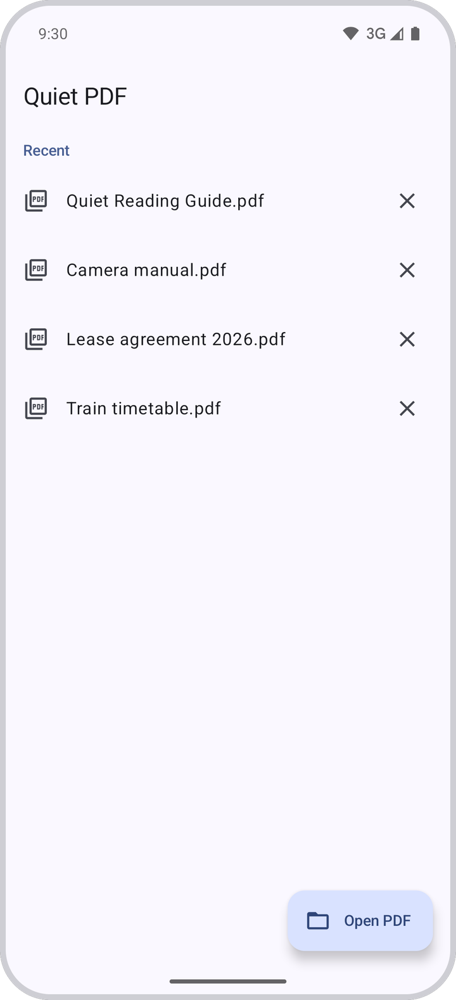

# Quiet PDF Reader

A small PDF reader for Android that just opens your PDFs.

No ads, no tracking, no accounts. The app has no internet permission, so it cannot send
anything anywhere.

<p align="center">
  
  
  
  
  
</p>

## Download

Get the APK from the [latest release](https://github.com/KalGeo/quiet-pdf/releases/latest)
and open it on your phone. The first time, Android asks you to allow your browser or file
manager to install apps.

## Features

- Continuous vertical scrolling with pinch and double-tap zoom; pages are re-rendered sharper when you zoom in
- Full-screen reading: the bars hide as soon as you scroll and come back with a tap
- Text search with highlighted results (Android 15 and newer)
- Night mode
- Printing, through Android's own print dialog (printers or Save as PDF)
- Go to page, by number or with a slider
- Remembers exactly where you stopped in each file, however you open it next time
- Recent files list
- Shows up in "Open with" for PDFs in other apps
- English and Greek interface

Not supported: password-protected PDFs, text selection, annotations, form filling.

## Requirements

Android 8.0 (API 26) or newer. Text search needs Android 15 (API 35) or newer, because it
uses the search built into the platform PDF renderer; on older versions the search button
is hidden and everything else works.

## Privacy

Quiet PDF Reader collects nothing. See [PRIVACY.md](PRIVACY.md).

## Building

You need a full JDK 17 or newer and the Android SDK (platform 36).

```sh
./gradlew assembleRelease
```

The APK is written to `app/build/outputs/apk/release/`. Official releases are signed with a
key described by a `keystore.properties` file that is not in the repository; without that
file the release APK is unsigned. To try the app on your own device, build and install a
debug version instead:

```sh
./gradlew installDebug
```

## Ελληνικά

Το Quiet PDF Reader είναι ένας μικρός αναγνώστης PDF για Android που απλώς ανοίγει τα PDF
σου: χωρίς διαφημίσεις, χωρίς παρακολούθηση, χωρίς λογαριασμούς και χωρίς πρόσβαση στο
internet. Τα μενού της εφαρμογής είναι και στα ελληνικά. Κατέβασε το APK από την
[τελευταία έκδοση](https://github.com/KalGeo/quiet-pdf/releases/latest).

## License

Copyright (C) 2026 Georgios Kakavelakis

This program is free software: you can redistribute it and/or modify it under the terms of
the GNU General Public License version 3 as published by the Free Software Foundation.

This program is distributed in the hope that it will be useful, but WITHOUT ANY WARRANTY;
without even the implied warranty of MERCHANTABILITY or FITNESS FOR A PARTICULAR PURPOSE.
See [LICENSE](LICENSE) for the full text.
